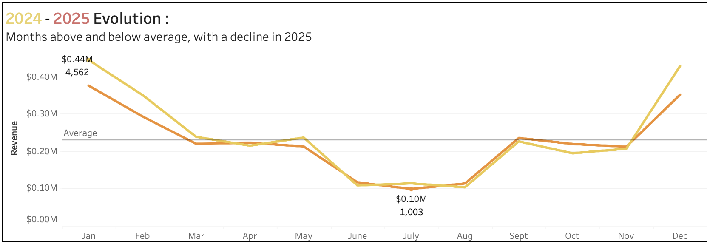
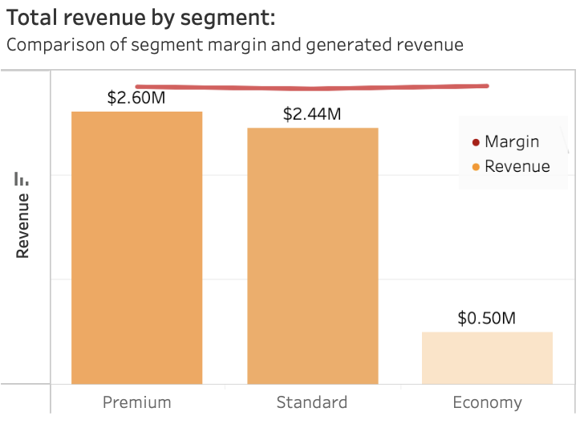
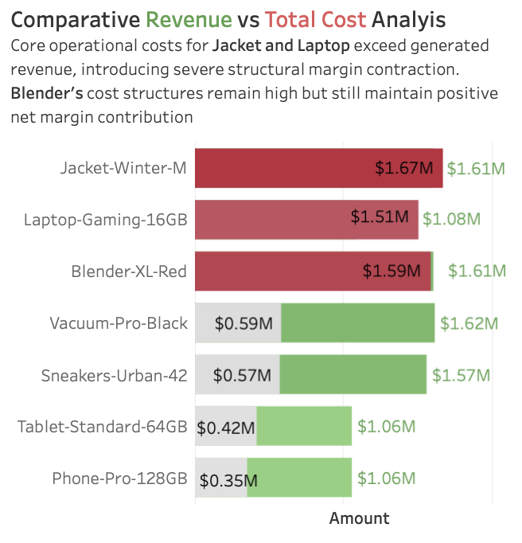
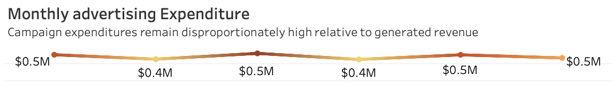

# Macarena Hülsken — Data Analyst

#### Technical Skills: Python (Pandas, NumPy) | SQL | Tableau | Power BI | Excel

**Location:** Adelaide, SA, Australia  
**Email:** [macarenahulsken@gmail.com](mailto:macarenahulsken@gmail.com)  
**Phone:** +61 431 212 300  
**LinkedIn:** [Macarena Hülsken](https://www.linkedin.com/in/macarena-hulsken)  
**GitHub:** [macarenahulsken](https://github.com/macarenahulsken)

---

## About Me
I am a Data Analyst passionate about sales analytics and commercial performance. Having grown up closely involved in my family’s sales business, I developed an early, hands-on understanding of business operations and the vital role data plays in driving revenue, solving operational challenges, and guiding strategic decisions.

Through intensive training at TripleTen, I gained solid technical proficiency in Python, SQL, Tableau, and statistical analysis, building end-to-end workflows to turn raw datasets into actionable insights. Having worked in collaborative and fast-paced environments, I bring strong cross-functional communication and team problem-solving skills.

## Education
* **Data Analysis Professional Certification** | TripleTen (2025 – 2026)
* **Bachelor of Science in Marketing (2 Years Completed)** | UNC – Argentina (2021 – 2023)

---

## Portfolio Projects

### 1. Commercial Performance & Profitability Analysis (2024–2025) | Andes Retail Group
🔗 **[View Live Dashboard (Tableau)](https://public.tableau.com/app/profile/macarena.hulsken/viz/andes-retail-performance/Diagnosticocomercial)** | **[View Project Files](https://github.com/macarenahulsken/andes-retail-performance)**

* **📌 Project Overview:** Transformed dispersed multi-country transactional data (Peru, Chile, and Colombia) into an actionable visual narrative to evaluate revenue drivers, profitability, customer behavior, and regional performance across 2024–2025.
* **🛠️ Tools & Technologies:** Tableau (Interactive Dashboards), Excel / Power Query (Data Cleaning & Wrangling), SCQA Framework.

### 📊 Executive Summary (SCQA Framework)

**1. General Overview & Seasonality**

* **Situation:** 2024 closed with strong performance, but looking at the full timeline, sales follow a clear cyclical pattern.
* **Complication:** Revenue drops drastically during the cold months, hitting a low of $0.10M in July.
* **Question:** How does seasonality impact our annual performance?
* **Answer (Recommendation):** Implement a winter promotional calendar or boost high-AOV categories to offset the mid-year slump.

**2. Segment & Category Diagnostic**

* **Situation:** The business relies heavily on the Premium ($2.60M) and Standard ($2.44M) tiers.
* **Complication:** The *Economy* segment generates a marginal share ($0.50M), indicating a potential pricing or market fit mismatch.
* **Question:** Why are we failing to capture entry-level customers?
* **Answer (Recommendation):** Conduct a competitive pricing audit and benchmarking for entry-level products.

---

### 2. Commercial Performance & Unit Economics Audit | RappiPlus
🔗 **[View Code on GitHub](https://github.com/macarenahulsken/RappiPlus-Commercial-Performance-Growth-Analysis)** | **[View Live Dashboard (Tableau)](https://public.tableau.com/app/profile/macarena.hulsken/viz/ProyectoRappiPlus/OverviewEjecutivo)**

* **📌 Project Overview:** Audited regional sales data, unit economics, and checkout conversion performance to diagnose critical gross margin losses, optimize marketing spend allocation, and evaluate a new UI checkout experience.
* **🛠️ Tools & Technologies:** SQL (Joins, Aggregations), Python (Pandas, SciPy — A/B Hypothesis Testing), Tableau (Dual-View Executive & Operational Dashboard).

#### 📊 Executive Summary (SCQA Framework)

**1. Unit Economics & Profit Leakage Diagnostic**

* **Situation:** Overall commercial operations generated $9.61M in total revenue and $2.91M in net profit across seven core product lines.
* **Complication:** A unit-level cost vs. revenue audit revealed a severe **$0.48M gross margin loss** concentrated in two high-volume items: *Laptop-Gaming-16GB* ($1.08M revenue vs. $1.51M cost) and *Jacket-Winter-M* ($1.61M revenue vs. $1.67M cost), driven by aggressive promotional discounts pushing final prices below unit cost.
* **Question:** How can we immediately stop profit erosion while maintaining sales volume?
* **Answer (Strategic Recommendations):**
  * **Automated Pricing Guardrails:** Implement ERP/POS system alerts to automatically block promotional discounts that push unit margins below zero.
  * **SKU Restructuring:** Audit supplier costs and revise discount tiers for *Laptop* and *Jacket* categories, shifting promotional focus toward high-margin drivers like *Vacuum-Pro-Black* and *Sneakers-Urban-42*.

**2. Marketing Efficiency & Seasonality Alignment**

* **Situation:** Monthly advertising expenditure remained static between $0.4M and $0.5M throughout the first half of the year, totaling $2.87M (nearly 30% of total revenue).
* **Complication:** In February, total revenue experienced a sharp systemic contraction across all regional markets (dropping from $1.7M to $1.4M), yet marketing expenditure failed to adjust to lower seasonal demand.
* **Question:** How should marketing budgets be managed to maximize Return on Ad Spend (ROAS)?
* **Answer (Strategic Recommendations):**
  * **Dynamic Budget Allocation:** Transition from flat monthly ad spend to a demand-driven model, scaling back acquisition spend during seasonal troughs (February) and reinvesting during peak conversion windows (March and May).

---

### 3. User Behavior & Subscription Tier Analysis | ConnectaTel
🔗 **[View Code & Notebook on GitHub](https://github.com/macarenahulsken/connectatel-data-analysis)**

* **📌 Project Overview:** Analyzed behavioral usage patterns across 4,000 telecom customers (calls, messaging, and data consumption) to identify high-value segments and optimize subscription tier structures.
* **🛠️ Tools & Technologies:** Python (Pandas, NumPy, Matplotlib, Seaborn), Data Cleaning & Imputation, Outlier Winsorization, Customer Segmentation.

#### 📊 Executive Summary

* **Data Engineering & Statistical Methodology:**
  * Merged and standardized three relational datasets (*Users, Plans, Usage*), resolving an **11.7% missing geographic data gap** via Median Imputation.
  * Applied **Winsorization** via NumPy to the top 3% of call duration outliers to prevent statistical skew while preserving "Power User" profiles.
* **Key Analytical Findings:**
  * Engineered a multi-tier segmentation framework (*Usage Tiers & Demographic Brackets*) isolating distinct user personas, including high-frequency messaging users and long-duration callers.
  * Identified a significant volume of *Basic* plan subscribers consistently exceeding their monthly allowances and paying overage fees.
* **Strategic Recommendations:**
  * Introduce a **"Basic Plus" intermediate subscription tier** priced between the Basic and Pro plans to capture mid-market demand, improve retention, and increase predictable recurring revenue (ARPU).

